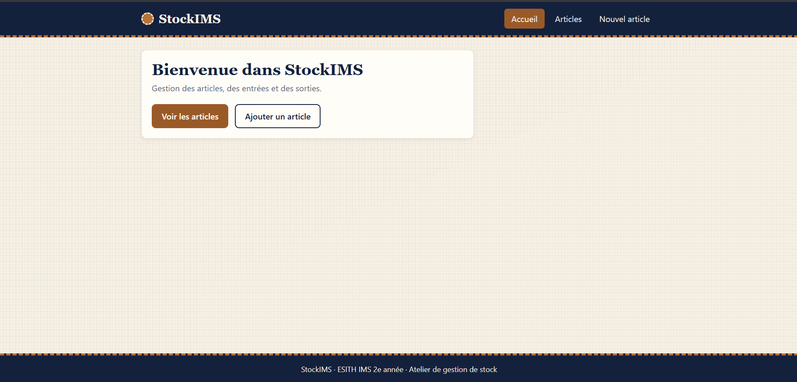
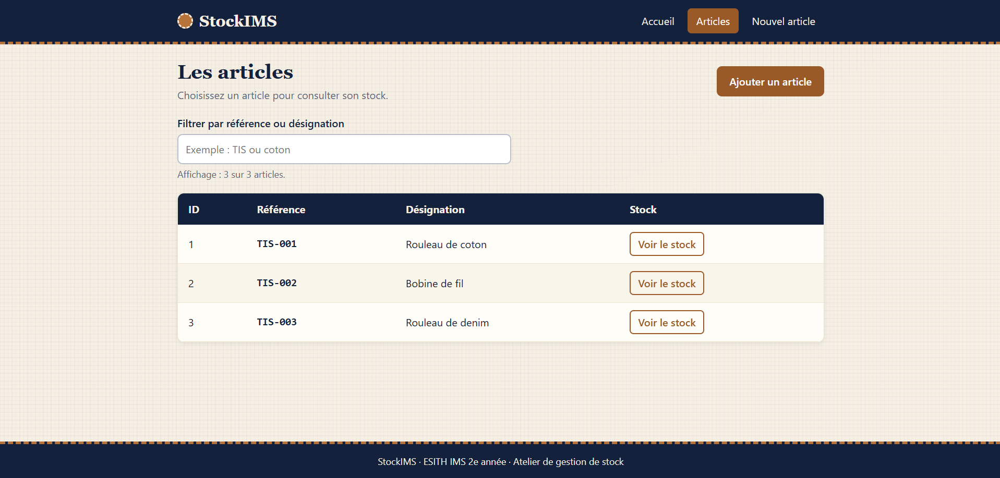
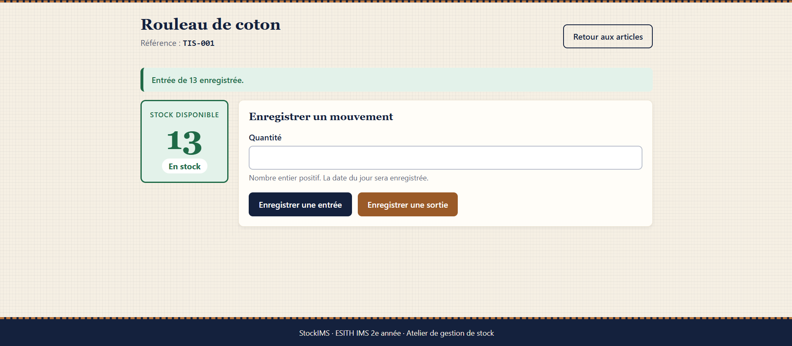
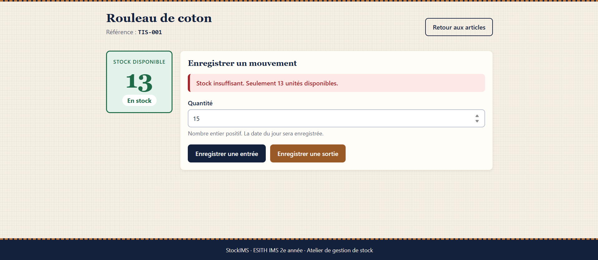

# StockIMS

Application web de gestion de stock pour un atelier textile.
Projet de Spring Boot, ESITH, IMS 2e année, Java et programmation orientée objet.

## Participants

- Étudiant 1 : HARMANE Mohamed Amine
- Étudiant 2 : SOUBA Hamza

## Fonctionnalités

- Ajouter un article (référence unique et désignation).
- Consulter la liste des articles, avec un filtre par référence ou désignation.
- Ouvrir la fiche d'un article avec le lien « Voir le stock ».
- Enregistrer une entrée ou une sortie de stock.
- Stock calculé à partir des mouvements : somme des entrées moins somme des sorties.
- Refus d'une sortie supérieure au stock disponible.

## Technologies

Java 21, Spring Boot, Spring Data JPA, MySQL local, Thymeleaf, Lombok, Maven Wrapper.
Interface en HTML, CSS et JavaScript natifs.

## Prérequis

- JDK 21 installé (vérification : `.\mvnw.cmd -v` doit afficher `Java version: 21`).
- MySQL en local, démarré (port 3306 par défaut).
- Un éditeur : VS Code ou IntelliJ IDEA.
- Aucune installation de Maven : le projet contient le Maven Wrapper (`mvnw`, `mvnw.cmd`).

## Installation de la base de données

Le fichier `sql/stockims.sql` crée la base `stockims_db`, les trois tables
`article`, `entree` et `sortie` avec leurs contraintes, et trois articles de test
sans aucun mouvement (stock de 0).

**Attention :** ce script supprime puis recrée ces trois tables. Il sert aussi à rejouer
le scénario depuis un stock de 0.

Avec MySQL Workbench : menu File, Open SQL Script, choisir `sql\stockims.sql`,
puis cliquer sur l'éclair jaune.

Avec le terminal Windows (adapter le chemin de `mysql.exe` à ton installation) :

```powershell
& "C:\Program Files\MySQL\MySQL Server 8.0\bin\mysql.exe" -u root -p --default-character-set=utf8mb4 -e "source sql/stockims.sql"
```

## Paramètres MySQL à adapter

Le fichier `src/main/resources/application.properties` contient un mot de passe factice
(`VOTRE_MOT_DE_PASSE`). Aucun mot de passe réel n'est publié.

1. Crée le fichier `src/main/resources/application-local.properties` (il est ignoré par Git).
2. Mets-y ton mot de passe MySQL :

```properties
spring.datasource.password=TON_MOT_DE_PASSE_MYSQL
```

Si besoin, tu peux aussi y ajouter `spring.datasource.username=...` ou
`spring.datasource.url=...` pour changer l'utilisateur ou le nom de la base.

Valeurs par défaut : base `stockims_db`, utilisateur `root`, MySQL sur `localhost:3306`.

## Lancer l'application (Windows)

Dans un terminal ouvert à la racine du projet (le dossier qui contient `pom.xml`) :

```powershell
.\mvnw.cmd -v
.\mvnw.cmd spring-boot:run
```

Quand la console affiche `Started StockimsApplication`, ouvrir :

- http://localhost:8080/ (accueil)
- http://localhost:8080/articles (liste des articles)

Arrêter l'application : `Ctrl+C` dans le terminal. Une seule instance doit tourner
(sinon le port 8080 est occupé).

macOS et Linux : remplacer `.\mvnw.cmd` par `./mvnw`.

## Scénario de vérification

Partir de la base fraîchement importée (stock de 0), puis ouvrir la fiche de TIS-001
depuis la liste (lien « Voir le stock »).

| # | Action | Résultat attendu |
|---|---|---|
| 1 | Ouvrir la fiche de TIS-001 | Stock 0, « En rupture » |
| 2 | Entrée de 20 | Stock 20 |
| 3 | Sortie de 7 | Stock 13 |
| 4 | Sortie de 15 | Refus : « Stock insuffisant. Seulement 13 unités disponibles. » Stock toujours 13, aucune ligne ajoutée dans `sortie` |
| 5 | Quantité vide | « La quantité est obligatoire. » |
| 6 | Quantité 0 ou -1 | « La quantité doit être positive. » |
| 7 | Quantité 2.5 ou texte (requête POST directe) | « Veuillez saisir un nombre entier. » |
| 8 | Article avec la référence TIS-001 | « Cette référence existe déjà. » |
| 9 | Article avec champs vides ou espaces | Messages « obligatoire » |
| 10 | Arrêter puis relancer l'application | Articles, mouvements et stock 13 toujours présents |

Le navigateur bloque lui-même `2.5` dans le champ numérique. Pour tester le serveur
directement (PowerShell, `curl.exe` avec `.exe`, remplacer `1` par l'id de l'article) :

```powershell
curl.exe -s -X POST -d "quantite=2.5" http://localhost:8080/stock/1/entrees | findstr /C:"entier"
curl.exe -s -X POST -d "quantite=15"  http://localhost:8080/stock/1/sorties | findstr /C:"insuffisant"
```

Vérification dans MySQL :

```sql
USE stockims_db;
SELECT quantite, date_mouvement FROM entree WHERE article_id = 1 ORDER BY id;
SELECT quantite, date_mouvement FROM sortie WHERE article_id = 1 ORDER BY id;
```

Résultat attendu : une entrée de 20, une sortie de 7, aucune ligne de 15.

## Captures d'écran

La fenêtre d’accueil :



Liste personnalisée des articles :



Fiche de TIS-001 avec un stock de 13 :



Même fiche après le refus de la sortie de 15 :



## Personnalisations réalisées

- Identité visuelle « atelier textile » : bleu nuit, beige clair, accent cuivre, trait de
  « couture » en pointillés dans l'en-tête et le pied de page.
- Interface écrite en HTML, CSS et JavaScript natifs. Le CSS et le JavaScript sont dans
  `src/main/resources/static/` et référencés avec Thymeleaf.
- Fragments Thymeleaf communs (`templates/fragments/layout.html`) : en-tête, navigation, pied de page.
- Indicateur de stock en couleur avec texte : rupture (0), stock faible (1 à 9), en stock (10 ou plus).
- Trois types de messages distincts : succès (vert), erreur de champ (sous le champ),
  erreur du formulaire (bandeau rouge).
- Filtre JavaScript par référence ou désignation, insensible aux majuscules et aux accents.
  Sans JavaScript, le tableau complet reste affiché.
- Affichage adapté aux petits écrans : le tableau devient une liste de cartes.
- Message de refus de sortie personnalisé, avec singulier et pluriel.
- Plafond de 1 000 000 sur la quantité d'un mouvement.
- Mot de passe MySQL isolé dans un fichier local ignoré par Git.
- Script SQL avec contraintes (UNIQUE, clés étrangères, quantités strictement positives).